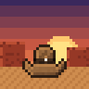

# Wild West Universe

The Old West in one mod for **Minecraft Java 1.21.1** (Fabric). Wild West Universe turns the Overworld into the
frontier — red mesas, deep canyons, dry savannas and dusty frontier towns — and fills it with everything that goes
with it: realistic horses and wagons, revolvers, rifles and dynamite, outlaw gangs and wanted bosses, desert wildlife,
dollars and shops, duels at high noon, western clothing and a steam train you can drive (or rob).

Everything is built in a voxel style that matches vanilla Minecraft.

> Wild West Universe is closed-source software: this repository only publishes the compiled builds
> ([Releases](https://github.com/RaulDevStack/wild-west-universe/releases)). The source code is not public.

## Requirements

| | |
|---|---|
| Wild West Universe file | `wild-west-universe-1.0.0_1.21.1.jar` |
| Minecraft | Java Edition 1.21.1 |
| [Fabric Loader](https://fabricmc.net/use/) | 0.20.1 or newer |
| [Fabric API](https://modrinth.com/mod/fabric-api) | 0.116.17+1.21.1 or newer |
| Java | 21 |

The mod is needed on **both the client and the server**.

## Installation

1. Install Fabric Loader for Minecraft 1.21.1.
2. Download the `.jar` from the [releases](https://github.com/RaulDevStack/wild-west-universe/releases).
3. Put it, together with Fabric API, in the `mods` folder of your Minecraft installation (and of your server).
4. Launch the game with the Fabric profile and **create a new world**: the western terrain only appears in chunks that
   are generated with the mod installed.

## Controls

All keys can be changed in *Options → Controls* (category *Wild West Universe*).

| Key | Action |
|---|---|
| Your **sprint** key + **W** (riding) | Gallop (uses the horse's stamina) |
| **Left Alt** (riding) | Switch between walk and trot |
| Your **sneak** key (riding) | Dismount |
| **J** (riding) | Hitch or unhitch the nearest wagon |
| **H** | Whistle for your horse |
| **R** | Reload the gun in your hand |
| **B** | Open the satchel you are wearing |
| **Right click** (gun) | Fire |
| **Hold and release right click** (tomahawk) | Throw it |
| **W / S** (driving a locomotive) | Open the throttle / brake and reverse |

## Features

### The West
- A new Overworld with **no oceans, snow or jungles**: desert, badlands, savanna and rivers, plus three new biomes —
  **Red Mesa** (banded terracotta buttes), **Sagebrush Flats** (dry grassland) and **Canyon River** (wide rivers cutting
  through the uplands). Plateaus are taller, so rivers carve real **canyons**.
- Caves are untouched (lush caves, dripstone caves and the deep dark are still there).
- A warm sky, a sandy distance haze and savanna trees made of oak.
- **Tumbleweeds** roll across dry biomes with the wind (which slowly changes direction and gusts). Break one for a stick.
- More farm animals and husks, fewer zombies, creepers and skeletons, no drowned, and a **Desert Skeleton**.

### Frontier towns and places
- **Western towns** grow around a plaza with a saloon: brick houses, general store, sheriff's office with a cell,
  stables, corrals, blacksmith, chapel, water tower, cabins and shacks, with townsfolk in their shops.
- **Ranches** with a ranch house, stables full of horses and a cattle corral.
- **Outlaw hideouts** tucked into rock horseshoes, guarded by a gang and its leader.
- **Wrecked stagecoaches** with luggage and loot.
- **Train stations** with a platform, a station house, a water tower and a train waiting on the siding.

### Horses
Vanilla horses are replaced by a realistic, fully animated voxel horse (all vanilla coats and markings).
- **Gaits:** walk, trot and gallop, with real four-beat and diagonal leg patterns, plus idle behaviour (grazing,
  tail flicks, ear movement, rearing).
- **Stamina:** galloping tires the horse (about 90 seconds at full stamina); it recovers walking or standing.
  Each horse has its own maximum, inherited by its foals.
- **Hunger:** tamed horses need food — oats (dropped by grass), hay, wheat, apples and carrots.
- **Horseshoes** (iron, gold, diamond): without them, hard ground wears the hooves down and the horse goes lame.
- **Mares and stallions:** only opposite sexes breed.
- **Whistle (H):** your last tamed horse gallops to you; if it is far away it appears nearby and walks over.
- **Swimming:** ridden horses swim with the rider above water and climb out onto the bank.
- **Tack:** western saddle (dyeable), bridle, Navajo saddle blankets (4 patterns), saddlebags (9 slots) and a rifle
  scabbard — all visible on the horse. Sneak + right click (or the inventory key while riding) opens the horse's gear menu.
- **Wild herds:** horses that spawn naturally live in herds of 3–7 led by a **stallion**. Herd horses are faster,
  stronger and have more stamina, but are harder to tame. Mares shy away if you walk up openly (sneak to get close),
  and the stallion charges anyone approaching his herd.

### Wagons
- **Covered wagon** (27 storage slots and a seat) and **cargo cart** (short two-wheeled cart with a chest).
- Hitch them with **J** while riding. They follow your horse, float on water and climb out with it, and come along
  when you whistle.

### Weapons
| Weapon | Details |
|---|---|
| **Revolver** | 6 rounds of .45 Colt, 4 hearts per shot, 48-block range |
| **Lever-action rifle** | 8 rounds of .45-70, 7 hearts, 96-block range, very accurate |
| **Double-barrelled shotgun** | 2 12-gauge shells, 8 pellets per shot, short range |
| **Dynamite** | Lit and thrown; bounces, rolls and explodes after 3 seconds |
| **Tomahawk** | Light axe that can be thrown like a trident |
| **Bowie knife** | Fast melee weapon |

- Each gun only takes its own ammunition and is reloaded with **R**. A corner HUD shows the cylinder, the rounds left
  and your reserve.
- Shots hit instantly; headshots deal 50% more damage. Accuracy is better crouching and worse while riding, jumping or
  running.
- All weapons are 3D voxel models with firing and reloading animations (the cylinder turns, the lever works, the
  shotgun breaks open).
- Rifles and shotguns fit in the horse's rifle scabbard.

### Outlaws and wanted bosses
- **Outlaws** roam the West in gangs, shooting real revolvers. Their **leader** carries a rifle and never rides alone.
- **Wanted posters** turn up in town chests and wrecked stagecoaches (the sheriff sells them too). Carry one and it
  learns where its boss is hiding; right click to read it — a portrait, the bounty, the coordinates and the distance
  and direction from you.
- **Three bosses**, each with a boss bar, a gang and a fortified hideout:

| Boss | How he fights | Hideout | Reward |
|---|---|---|---|
| **"Black Jack" McCoy** | Fast, accurate gunslinger who fires in bursts and side-steps your shots | Rancho Diablo: a stockade with a two-storey saloon, watchtowers and gallows | $500 and the **Golden Revolver** |
| **"Dynamite" Dan** | Lobs dynamite at anyone keeping their distance and blasts close targets with his shotgun | Mina del Diablo: a mining camp built into a mesa | $750 and **"The Widow"** shotgun |
| **The Butcher** | Huge brute who hurls tomahawks and leaps to slam the ground | El Matadero: a stockade of hides and bones | $1000 and the **War Tomahawk**, which returns to your hand |

Below half health each boss gets angrier and whistles for three more outlaws.

### Wildlife
| Creature | |
|---|---|
| **Bison** | Grazes in herds on the plains; the adults charge if one is attacked. Meat, leather and bison fur. |
| **Scorpion** | Fast desert hunter with a poisonous sting. |
| **Coyote** | Packs that hunt chickens and rabbits at night; they only attack you if you hit one of them. |
| **Cougar** | A lone ambush hunter of the rocky badlands: it stalks you crouched and pounces. |
| **Vulture** | A scavenger that circles over dead animals and comes down to feed. Never attacks. |
| **Desert creepers** | Three new creepers alongside the normal one: the **sandblast creeper** (its blast breaks nothing but blinds you and rains sand), the **burrowing creeper** (hides under the sand by day and bursts out hissing) and the **cactus creeper** (spiny to touch, sprays spines when it blows). |

Animals that die now leave a **carcass** for a few minutes — which is what the vultures are looking for.

### Money and townsfolk
- **Dollars:** $1 bills, and a **wallet** that holds up to $10,000. Shops take and pay money automatically, from
  loose bills first and then from your wallet.
- Earn dollars by selling goods, collecting bounties, looting outlaws and chests, winning duels and robbing trains.
- **Townsfolk** with their own shops: storekeeper, bartender, gunsmith, horse trader (who sells tamed horses) and
  sheriff. Right click to open the shop; shift-click to trade ten times at once.

### Duels
The **gunslinger** in the saloon challenges you to a duel for $10, $50 or $100. Walk off twelve paces, wait for the
countdown and the signal — **DRAW!** — and be the first to hit. Fire early and you lose. The winner takes double the
stake; a duel never kills you.

### Clothing
Six pieces of western clothing, each with a practical perk. They are drawn as 3D voxel garments and are layered so
they combine with each other and with vanilla armour without any flickering.

| Piece | Perk |
|---|---|
| **Cowboy hat** | Headshots deal no extra damage; horses are easier to tame |
| **Outlaw bandana** | Outlaws take you for one of their own — until you attack one |
| **Duster coat** | 25% less damage from bullets and arrows |
| **Poncho** | Regeneration next to a lit campfire |
| **Chaps** | Cacti and berry bushes don't hurt |
| **Spurred boots** | Your horse gallops 10% faster and tires 25% slower |

### Camp gear
- **Satchels** have their own inventory slot (above the shield slot). Open the one you wear with **B**: leather
  (9 slots), bison hide (18) or tooled leather (27). The satchel is worn across your body.
- **Wineskin** (five swigs, refilled with sweet berries) and **bottles of beer**: 10 seconds of nausea, 30 seconds of
  regeneration.
- **Bedroll:** sleep anywhere to skip the night without moving your respawn point.

### The railway
- **Steam locomotive**, **passenger car** (four seats) and **mail car**. They run on ordinary rails: place the
  locomotive on the track, load it with coal, climb aboard and drive it with W and S. Cars placed behind it couple
  themselves and follow it around curves.
- Every train station has a train waiting on its siding. Lay track from the station to take it wherever you like.
- **Train robbery:** the mail car's safe only opens to dynamite. Blow it and you get the gold — and the train guards
  come after you.

### Advancements
An advancement tab, *Wild West*, with goals for dollars, duels, bounties, wild stallions, predators, driving a train
and robbing one.

## Configuration

Horse settings (speeds, stamina, hunger, hoof wear and more) are stored in `config/wildwestuniverse-horses.json`.
Missing values are filled in automatically.

## Compatibility notes

- The mod changes Overworld generation, so other mods that rewrite the Overworld's biome layout may conflict with it.
- Vanilla horses are replaced (donkeys, mules and skeleton/zombie horses stay vanilla), so mods that replace the horse
  model may conflict too.
- Existing worlds keep their terrain; only newly generated chunks get the western landscape.

## License

Copyright (c) 2026 RaulDevStack. All rights reserved. See [LICENSE](LICENSE).

Minecraft is a trademark of Mojang AB. Wild West Universe is not affiliated with Mojang AB or Microsoft.
